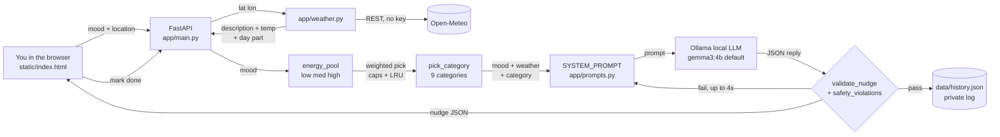

# Outdoor Nudge

Outdoor Nudge is a  local first web app. You type your mood in plain words
("restless and stuck at my desk"), it looks up the live weather for your spot
using Open-Meteo, and a local LLM (Ollama, `gemma3:4b` by default) comes up with
exactly one concrete outdoor task of about 20 minutes.

Each nudge has a title, step by step instructions, why it fits your mood and
weather, what to bring, an energy level, and a category. The front end is a
single page (`static/index.html`) served at `/`, with a FastAPI API behind it.
No paid APIs, no accounts, no sign up.

## Problem Statement

**The problem.** You feel restless or drained at your desk. You know a short
break outside would help, but in the moment you can't think of anything specific
to do. So you scroll instead, or take the same boring loop around the block.


**What this does differently.** It mixes free live weather (Open-Meteo) with a
local LLM (Ollama), then runs every suggestion through a strict prompt and a
server side safety check. What you get is one concrete, safe, 20 minute mission
matched to your mood, the weather, and the part of day. Free, private, and it
works offline apart from the weather lookup.

## Features

* Mood to mission. Free text mood gets mapped to an energy level (low, medium,
  high) and a task category. You get back a title, 2 to 4 sentences of steps,
  a why it fits line, what to bring, minutes, energy, and category.
* Weather aware. Open-Meteo lookup by lat/lon plus day part detection. Rain,
  snow, heat, or night reshapes the task (shelter, quiet doorstep only missions
  after dark). If the weather API is down, a manual override box lets you just
  describe it yourself.
* Safety and realism checks. The server rejects climbing, roads, water,
  eating or tasting stuff outside, bare hand contact with plants or litter,
  assumed objects (bench, bin, notebook...), generic "go for a walk" answers,
  and lonely mood missions with no real human contact. Up to 4 LLM retries
  per request.
* Stays fresh. Verb ban on the last 10 titles, category caps, and least recently
  used weighting, so back to back nudges feel different. "Give me another" and
  "Make it easier" buttons reuse your exclusions.
* Model picker plus compare. `/api/models` lists your local Ollama chat models,
  and the UI lets you pick one or run two side by side.
* Private local history. Every accepted nudge lands in `data/history.json`
  (gitignored). Collapsible History panel, newest first, with mark as done via
  `POST /api/done`.
* Plain responsive UI. One `static/index.html`, light and dark mode, background
  tint that reacts to the weather, geolocation button, 4 mood chips, fine at
  390px mobile width.

Not built yet: streaks and reminders, favorites, offline weather cache, PWA install.

## Demo

Open the app and try this:

```text
mood: "restless and stuck at my desk"
```

You might get back something like "Shadow Sprint Intervals": march briskly
along the sunny side of your building, race your own shadow between lamp posts
for 5 rounds, then finish with slow shoulder rolls at your door. 20 minutes,
high energy, movement category.

Screenshots live in `docs/screenshots/` (made by `tests/test_browser.py`).
There are desktop light and dark shots, a two model compare shot, the history
panel, the weather fallback box, and mobile 390px shots.

## How It Works

Pretty simple pipeline:

1. **Input.** Your mood text plus optional lat/lon, model, weather override,
   excluded titles, and an easier flag. All of it comes in through
   `POST /api/nudge`. The browser also grabs your location and hits
   `/api/weather`.
2. **Validation.** Pydantic makes sure the mood is not empty. `energy_pool()`
   guesses low, medium, or high from mood keywords. `pick_category()` then
   picks a category with caps and least recently used weighting.
3. **Processing.** `build_prompt()` stuffs the mood, weather, part of day,
   category, and exclusions into `SYSTEM_PROMPT`. `call_ollama_json()` asks
   Ollama. `validate_nudge()` checks the schema, the category and energy
   match, count and verb bans, and runs `safety_violations()`. Up to 4 tries,
   each retry telling the model what it got wrong.
4. **Storage and outside services.** Open-Meteo for weather (optional, the
   override works offline). Ollama on `OLLAMA_HOST` for the LLM (required).
   `data/history.json` as a small append only private log.
5. **Output.** JSON with title, task, why it fits, bring list, minutes, energy,
   category, weather, model, part of day, id, and a night flag. The page renders
   it as a card with Done, Another, and Easier buttons.

A few calls I made on purpose. Local LLM through Ollama (`gemma3:4b` default)
means zero cost and your moods never leave your machine, though speed and
quality depend on your hardware and which model you pulled. Routes stay thin
(`app/main.py`) and all the safety and realism rules live in plain Python
(`app/validation.py`), because the model is creative but not trustworthy, and
deterministic checks retry cleanly. History is a flat JSON file instead of a
database since this is a single user app and zero setup mattered more.

## Architecture

Here is the whole thing at a glance:



And if you prefer text:

```text
browser (static/index.html)
  |-- GET  /                     serves index.html
  |-- GET  /api/weather?lat&lon  app/weather.py talks to Open-Meteo
  |-- GET  /api/models           lists local Ollama chat models
  |-- POST /api/nudge            mood, lat/lon or weather_override,
  |                              model, exclude, easier
  |     pick energy + category (caps, least recently used)
  |     build prompt, ask Ollama, validate, retry up to 4 times
  |     save to history, return JSON nudge
  |-- GET  /api/history  +  POST /api/done
```

How data moves: mood plus location or weather text goes in, energy and category
get picked (respecting caps and your exclusions), the prompt gets built, Ollama
answers in JSON, the validator checks schema, safety, realism, and repeats,
then it either retries with feedback or accepts, saves, and renders.

Main pieces: `app/main.py` holds the routes and the retry loop.
`app/prompts.py` holds `SYSTEM_PROMPT` and the 9 task categories plus banned
cliches. `app/validation.py` holds `pick_category`, `validate_nudge`, and
`safety_violations` with all the verb, count, venue, and object bans.
`app/weather.py` fetches Open-Meteo and maps WMO codes plus day part.
`app/llm.py` calls Ollama and pulls out JSON. `app/history.py` reads and writes
`data/history.json` atomically. `app/config.py` holds env overridable defaults.
`static/index.html` is the whole front end: weather strip, mood form, compare
mode, history.

## Tech Stack

| What | Why it is here |
|---|---|
| Python 3.11+ | The whole backend |
| FastAPI 0.143 plus Uvicorn 0.54 | API and local server |
| Ollama 0.6.3 (`gemma3:4b` default) | Local LLM, swap in any model you have pulled |
| Open-Meteo REST through `requests` | Free weather, no key needed |
| Pydantic 2.14 | Request validation |
| Plain HTML, CSS, and JS in `static/index.html` | Front end, no build step |
| Playwright 1.63 | Browser tests and screenshots |

That is it. No database, no auth, no cloud SDKs, no JS framework. I kept it
boring on purpose so it runs anywhere.

## Codebase Structure

```text
Outdoor-Nudge/
├── app/
│   ├── main.py          # routes plus the nudge retry loop
│   ├── config.py        # env defaults (model, host, lat/lon, paths)
│   ├── prompts.py       # SYSTEM_PROMPT plus task categories
│   ├── validation.py    # category pick, schema and safety checks
│   ├── weather.py       # Open-Meteo fetch plus day part
│   ├── llm.py           # Ollama JSON call
│   ├── history.py       # history.json persistence
│   └── __init__.py      # re-exports safety_violations for tests
├── static/
│   └── index.html       # the whole UI
├── tests/
│   ├── test_safety_unit.py     # offline validator checks
│   ├── test_safety_fixes.py    # live LLM safety retest
│   ├── test_quality_retest.py  # 15 case quality harness
│   ├── test_browser.py         # Playwright UI tests plus screenshots
│   └── show_tasks.py           # small dev helper
├── docs/                # screenshots (generated)
├── data/                # history.json (auto created, gitignored, private)
├── .env.example         # every env var, all optional
├── requirements.txt     # pinned runtime plus test deps
├── LICENSE              # MIT
└── README.md
```

If you want to change behavior, start in `app/prompts.py` and
`app/validation.py`. New endpoints go in `app/main.py`, UI work goes in
`static/index.html`, and new checks go in `tests/`.

## Getting Started

### What you need

* Python 3.11 or newer, plus `pip`
* Ollama installed and serving (`ollama serve`)
* At least one chat model pulled, for example `ollama pull gemma3:4b`
* Internet for Open-Meteo weather (optional, the manual override works offline)

### Install

```bash
git clone https://github.com/PIYUSH-NEXTGEN/Outdoor-Nudge.git
cd Outdoor-Nudge
python -m venv venv
.\venv\Scripts\activate
pip install -r requirements.txt
ollama serve
ollama pull gemma3:4b
```

On macOS or Linux use `source venv/bin/activate` instead of the
`.\venv\Scripts\activate` line.

### Settings

Nothing is required. Defaults just work. If you want to change something,
export env vars (full list in `.env.example`):

```bash
set NUDGE_LAT=28.6139 & set NUDGE_LON=77.2090
```

That example is New Delhi on Windows. On macOS or Linux use
`export NUDGE_LAT=28.6139 NUDGE_LON=77.2090`.

### Run it

```bash
uvicorn app.main:app --host 127.0.0.1 --port 8000
```

Open http://127.0.0.1:8000 and you should see live weather in the strip.
Type a mood, hit Nudge me, and a mission card shows up. How fast depends on
your machine, on CPU only it can take a minute or two.

## Usage

Easiest path is the web UI. Open `/`, let it geolocate if you like, type a
mood, pick a model, hit Nudge me. From there you can ask for another one (it
remembers the last ones so it does not repeat), make it easier (forces low
energy), mark it done (saves that), or flip on Compare two models to run two
side by side. If weather is down, just describe it yourself, something like
`light drizzle, 11C, evening` works fine.

The API works too:

```bash
# health of deps
curl http://127.0.0.1:8000/api/weather?lat=28.61&lon=77.20
curl http://127.0.0.1:8000/api/models

# one nudge (weather_override lets you simulate any condition)
curl -X POST http://127.0.0.1:8000/api/nudge -H "Content-Type: application/json" -d ^
  "{\"mood\": \"restless and stuck at my desk\", \"weather_override\": \"clear sky, 22C, evening\"}"

# easier + avoid repeats + force night for testing
curl -X POST http://127.0.0.1:8000/api/nudge -H "Content-Type: application/json" -d ^
  "{\"mood\": \"drained\", \"easier\": true, \"exclude\": [\"Old Title\"], \"now_override\": \"2026-01-01T23:30\"}"
```

Example reply:

```json
{
  "title": "Shadow Sprint Intervals",
  "task": "Step outside and march briskly along the sunny side...",
  "why_it_fits": "Matches your restless mood on a clear evening...",
  "bring": ["comfortable shoes"],
  "minutes": 20, "energy": "high", "category": "movement",
  "weather": {"description": "clear sky", "temperature_c": 22},
  "model": "gemma3:4b", "part_of_day": "evening"
}
```

```bash
# 1. Install dependencies
python -m venv venv
.\venv\Scripts\activate        # Windows
pip install -r requirements.txt

# 2. Make sure Ollama is running and a chat model is pulled
ollama serve
ollama pull gemma3:4b

# 3. Run the API
uvicorn app.main:app --host 127.0.0.1 --port 8000
```

Open <http://127.0.0.1:8000> in your browser.

## Configuration Reference

| Variable | Needed? | Default | What it does |
|---|---|---|---|
| `OLLAMA_HOST` | No | `http://localhost:11434` | Local Ollama server URL |
| `NUDGE_MODEL` | No | `gemma3:4b` | Default chat model when request omits `model` |
| `NUDGE_LAT` / `NUDGE_LON` | No | `44.4268` / `26.1025` | Fallback location for `/api/weather` and nudges without lat/lon |
| `NUDGE_WEATHER_TIMEOUT` | No | `12` | Open-Meteo request timeout (seconds) |
| `NUDGE_HISTORY_FILE` | No | `data/history.json` | History file (gitignored, holds private moods) |
| `NUDGE_INDEX_FILE` | No | `static/index.html` | File served at `/` |

Full list is in `.env.example`. There are no API keys to set up, which is kind
of the point.

## Testing

```bash
.\venv\Scripts\python.exe tests\test_safety_unit.py     # offline validator checks, no server/LLM
.\venv\Scripts\python.exe tests\test_quality_retest.py  # 15-case quality harness (needs server + Ollama)
.\venv\Scripts\python.exe tests\test_safety_fixes.py    # live LLM safety retest (needs server + Ollama)
.\venv\Scripts\python.exe tests\test_browser.py         # Playwright UI tests + screenshots (needs server)
```

What they cover: `test_safety_unit.py` has around 70 cases for the validator
(eating and tasting, climbing, roads, water, litter gloves, assumed objects,
the night doorstep rule, the lonely contact rule, generic walks, chores).
`test_quality_retest.py` fires 15 mixed mood, weather, and time inputs at
`/api/nudge` and checks schema, plausibility, cliches, and duplicates.
`test_browser.py` walks 14 page flows and drops screenshots into
`docs/screenshots/`. No lint or type tooling set up.

## Security

- This is a single user local app. There is no auth, no sessions, no cookies.
Anyone who can reach your port can use it, so keep it on `127.0.0.1` and do
not put it on the open internet.
- Mood text is length checked and only ever pasted into an LLM prompt, lat/lon
are plain floats, history writes are atomic with a same title dedupe guard.
LLM output is treated as untrusted: anything that fails `validate_nudge()`
(schema, category and energy match, count, verb, and venue bans,
`safety_violations()`) gets retried and is never shown.
- No secrets needed. Open-Meteo takes no key, Ollama runs on your machine.
`data/history.json` has your private moods and is gitignored, please never
commit it. If you find a security problem, open a private issue or PR instead
of posting the exploit publicly.


